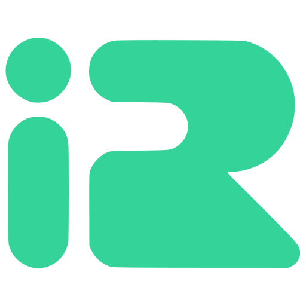

<p align="center">
  
</p>

<h1 align="center">IranRouter Node</h1>

<p align="center">
  راهنمای ساده اتصال به <a href="https://iranrouter.net">IranRouter</a> با Node.js
</p>

<p align="center">
  <a href="https://iranrouter.net"></a>
  &nbsp;
  
  &nbsp;
  
  &nbsp;
  
</p>

<p align="center">
  
</p>

IranRouter یک API سازگار با OpenAI است.
فقط `baseURL` و کلید API را عوض کنید — بقیه مثل OpenAI SDK است.

## شروع سریع

### ۱) کلید بگیرید

از [ثبت‌نام](https://iranrouter.net/register) حساب بسازید.
بعد در [داشبورد ← کلیدها](https://iranrouter.net/dashboard/keys) یک کلید `ir-…` بگیرید.

### ۲) نصب

```bash
npm install openai dotenv
```

یا کل این ریپو:

```bash
git clone https://github.com/BytelabsTeam/iranrouter-node.git
cd iranrouter-node
npm install
```

### ۳) کلید را ست کنید

```bash
export IRANROUTER_API_KEY="ir-..."
```

یا فایل `.env` بسازید (از روی `.env.example`).

### ۴) اولین درخواست

```js
import OpenAI from "openai";

const client = new OpenAI({
  apiKey: "ir-...", // یا از IRANROUTER_API_KEY بخوانید
  baseURL: "https://iranrouter.net/api/v1",
});

const response = await client.chat.completions.create({
  model: "deepseek/deepseek-flash",
  messages: [{ role: "user", content: "سلام" }],
});

console.log(response.choices[0].message.content);
```

با helper همین ریپو:

```js
import { IranRouter } from "iranrouter"; // یا از ../src/index.js

const client = IranRouter(); // از IRANROUTER_API_KEY می‌خواند

const response = await client.chat.completions.create({
  model: "openai/gpt-4o-mini",
  messages: [{ role: "user", content: "Hello!" }],
});
console.log(response.choices[0].message.content);
```

## اتصال در یک نگاه

| مورد | مقدار |
|------|--------|
| Base URL | `https://iranrouter.net/api/v1` |
| Auth | `Authorization: Bearer ir-…` |
| Env key | `IRANROUTER_API_KEY` |
| Docs | https://iranrouter.net/docs |
| مدل‌ها | https://iranrouter.net/models |

## نمونه‌ها

از ریشهٔ ریپو اجرا کنید:

```bash
cp .env.example .env   # کلید را داخلش بگذارید
node examples/01_chat.js
node examples/02_stream.js
node examples/03_models.js
node examples/04_check_key.js
node examples/05_embeddings.js
node examples/06_images.js
node examples/07_http_chat.js
```

| فایل | کار |
|------|-----|
| `examples/01_chat.js` | چت ساده |
| `examples/02_stream.js` | استریم |
| `examples/03_models.js` | فهرست مدل‌ها |
| `examples/04_check_key.js` | وضعیت کلید / اعتبار |
| `examples/05_embeddings.js` | embedding |
| `examples/06_images.js` | تولید تصویر |
| `examples/07_http_chat.js` | چت با `fetch` خالص (بدون OpenAI SDK) |

## استریم

```js
import { IranRouter } from "./src/index.js";

const client = IranRouter();

const stream = await client.chat.completions.create({
  model: "deepseek/deepseek-flash",
  messages: [{ role: "user", content: "یک داستان کوتاه بگو" }],
  stream: true,
});

for await (const chunk of stream) {
  const text = chunk.choices[0]?.delta?.content;
  if (text) process.stdout.write(text);
}
```

## HTTP بدون SDK

```js
const apiKey = process.env.IRANROUTER_API_KEY;

const res = await fetch("https://iranrouter.net/api/v1/chat/completions", {
  method: "POST",
  headers: {
    Authorization: `Bearer ${apiKey}`,
    "Content-Type": "application/json",
  },
  body: JSON.stringify({
    model: "deepseek/deepseek-flash",
    messages: [{ role: "user", content: "سلام" }],
  }),
});

const data = await res.json();
console.log(data.choices[0].message.content);
```

## مدل‌های رایج

شناسه را از [کاتالوگ](https://iranrouter.net/models) کپی کنید. چند نمونه:

- `deepseek/deepseek-flash` — مناسب شروع / سطح رایگان
- `openai/gpt-4o-mini` — چت سبک
- `openai/gpt-4o` — چت قوی‌تر
- `openai/gpt-image-2.5-sunburst` — تصویر

سطح رایگان روی بعضی مدل‌ها فعال است؛ جزئیات در [مستندات](https://iranrouter.net/docs#free-tier).

## endpointهای اصلی

| متد | مسیر |
|-----|------|
| `GET` | `/models` |
| `GET` | `/key` |
| `POST` | `/chat/completions` |
| `POST` | `/embeddings` |
| `POST` | `/images/generations` |
| `POST` | `/images/edits` |
| `POST` | `/videos/generations` |
| `GET` | `/generation/{id}` |

## نکات

- کلید را در کد commit نکنید؛ از env استفاده کنید.
- اگر قبلاً OpenAI / OpenRouter داشتید، فقط URL و کلید را عوض کنید.
- پاسخ chat موفق معمولاً هدر `X-Request-Id` دارد.
- خطای سهمیه رایگان تمام‌شده معمولاً HTTP `402` است.
- Node.js 18+ لازم است (`fetch` داخلی).

## لینک‌ها

- سایت: https://iranrouter.net
- مستندات API: https://iranrouter.net/docs
- کلیدها: https://iranrouter.net/dashboard/keys
- شارژ اعتبار: https://iranrouter.net/dashboard/credits
- نسخهٔ پایتون: https://github.com/BytelabsTeam/iranrouterPython

## کمک و مشارکت

اگر راهنمایی، مثال بیشتر، یا بهبودی لازم داشتید:

- در [Issues](https://github.com/BytelabsTeam/iranrouter-node/issues) بنویسید
- یا درخواست‌تان را در [Wiki](https://github.com/BytelabsTeam/iranrouter-node/wiki) بگذارید

MIT — [Bytelabs](https://github.com/BytelabsTeam)
